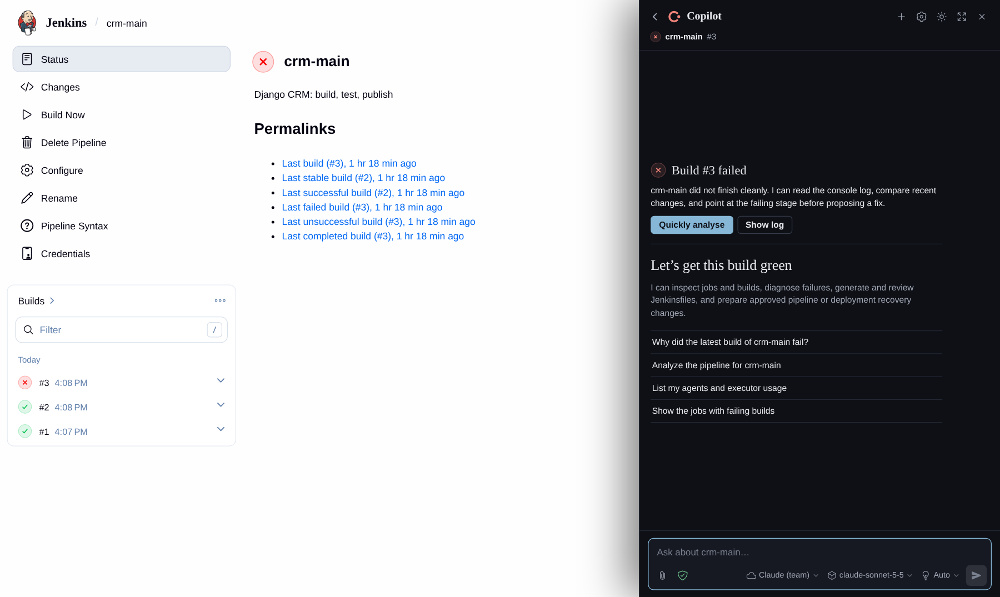
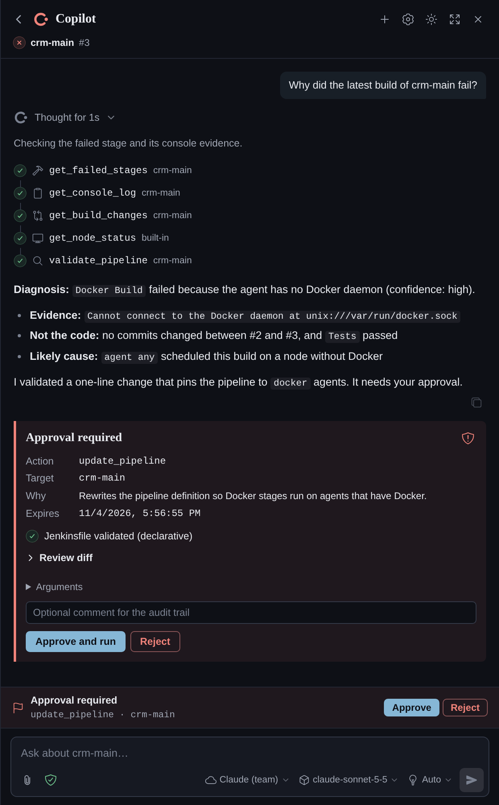
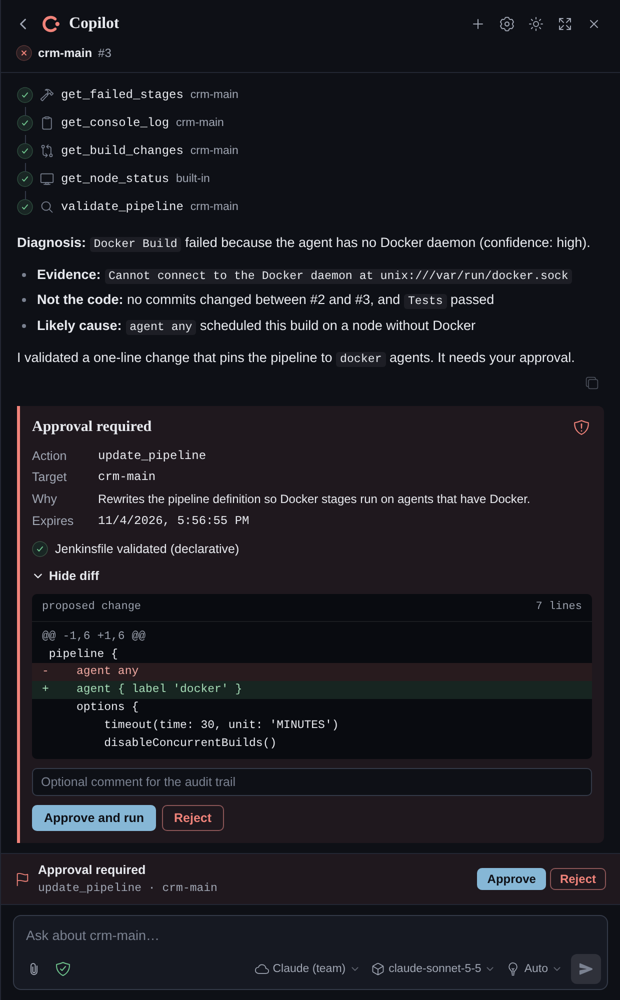
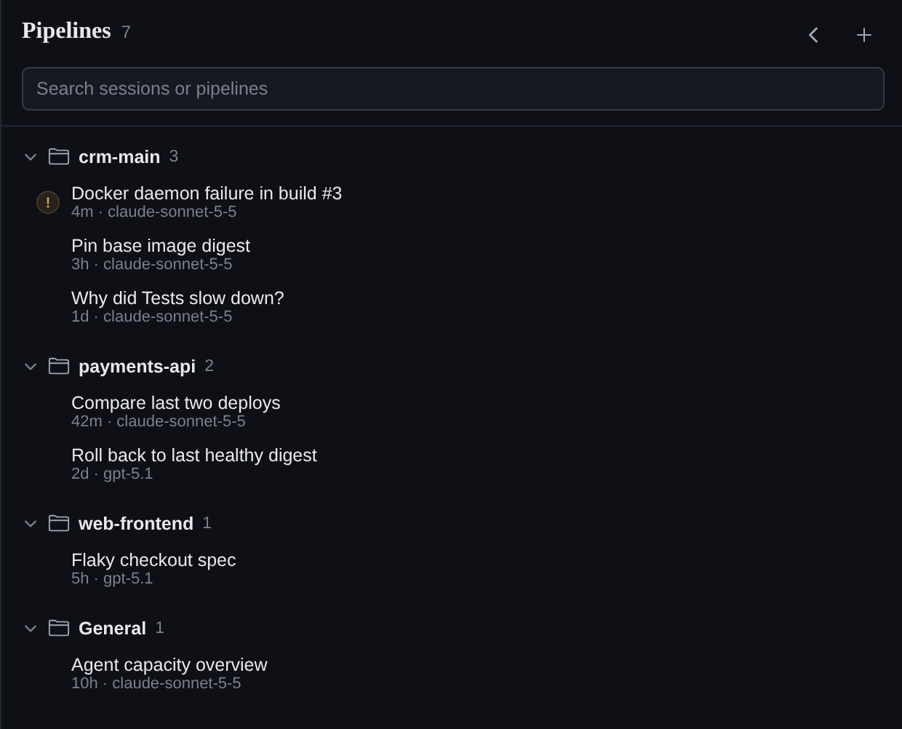
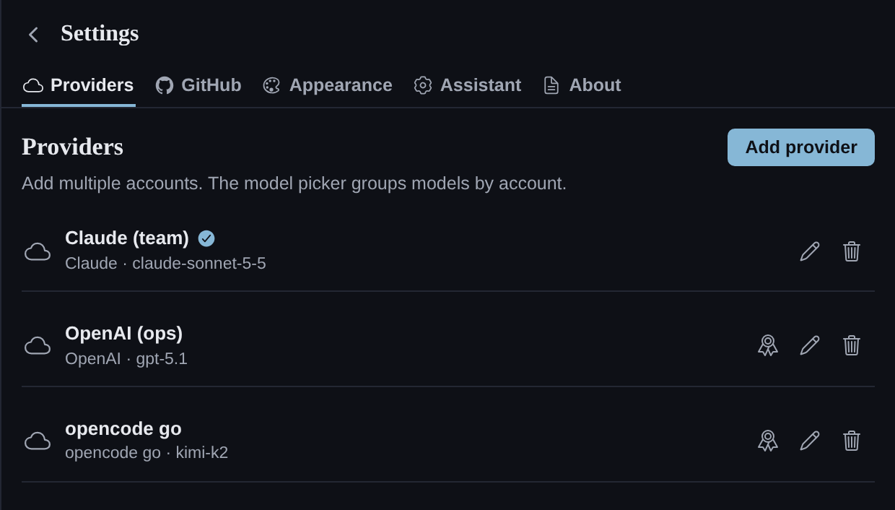

<p align="center">
  
</p>

<p align="center">
  <a href="https://github.com/notzeman/jenkins-copilot/releases/latest"></a>
  
  
  <a href="LICENSE"></a>
</p>

<p align="center">
  <a href="#install">Install</a> ·
  <a href="#first-run-setup">Setup</a> ·
  <a href="#what-it-can-do">Capabilities</a> ·
  <a href="#approvals">Approvals</a> ·
  <a href="#security">Security</a> ·
  <a href="#documentation">Docs</a>
</p>

An agentic CI/CD assistant that installs as a single Jenkins plugin. Click the floating button, choose a provider, paste an API key, and chat. It works with **OpenAI**, **Claude**, **opencode go**, and custom OpenAI-compatible endpoints.

## See it in Jenkins

When the latest build fails or is unstable, the floating icon pulses and offers **Quickly analyse**, which starts an investigation with the console log and recent changes.

<p align="center">
  
</p>

<table>
  <tr>
    <td width="50%"></td>
    <td width="50%"></td>
  </tr>
  <tr>
    <td><b>Diagnose from evidence.</b> Tool calls are visible as they run, followed by the cause and a confidence label.</td>
    <td><b>Review before anything changes.</b> Approval cards show risk, validation, and the exact diff.</td>
  </tr>
  <tr>
    <td></td>
    <td></td>
  </tr>
  <tr>
    <td><b>Sessions by pipeline.</b> Search, rename, and pick up where you left off.</td>
    <td><b>Multiple provider accounts.</b> Each one keeps its own encrypted key and default model.</td>
  </tr>
</table>

<sub>Screenshots show the real plugin UI on a demo Jenkins. Jobs and builds are demo runs; conversations, sessions, and provider accounts are sample data.</sub>

## What it can do

**Investigate**

- Inspect jobs, folders, builds, agents, executors, queues, plugins, credentials metadata, and SCM config.
- Read bounded console evidence and extract the failed stage and failure signals.
- Identify the exact commit SHA recorded by a build; never substitute branch HEAD.
- Diagnose dependency, Docker, registry, SSH, network, credential, database, Kubernetes, agent, memory, permission, and pipeline-syntax failures with a confidence label.

**Change and recover**

- Read and analyze Jenkinsfiles; propose validated changes with a diff and source-hash guard.
- Create, copy, update, enable, disable, and delete jobs; trigger, abort, and retry builds.
- Inspect GitHub repositories, files, commits, and comparisons; prepare recovery branches and pull requests.
- Track known-good builds and deployment records; propose digest-pinned rollbacks.

**Administer**

- Manage views and dashboards: create List/All views, add or remove jobs, set regex filters, rename, delete, and set the primary view.
- Manage folders, permanent agents, queue items, system-scope and folder-scope credentials, users in the private realm, the Global Matrix permission matrix, plugins, and controller settings.

## Install

**Requires** Jenkins 2.580.2 or newer on Java 21.

1. Download `jenkins-ai-copilot.hpi` from the [latest release](https://github.com/notzeman/jenkins-copilot/releases/latest). A SHA-256 checksum is published beside it.
2. In Jenkins, go to **Manage Jenkins → Plugins → Advanced settings → Deploy plugin → Choose file**.
3. Upload the HPI and restart Jenkins. The plugin is now active on every page.

## First-run setup

1. Sign in as a Jenkins administrator.
2. Click the floating button in the bottom-right corner, or press `Ctrl+J`.
3. With no provider configured, the drawer opens **Settings → Providers**.
4. Click **Add provider** and choose **OpenAI**, **Claude**, **opencode go**, or a custom OpenAI-compatible endpoint.
5. Paste the API key, plus the base URL for opencode go or a custom endpoint.
6. Click **Load models**, choose a default model, then **Save provider**.
7. To use repository tools, add a GitHub token under **Settings → GitHub**.

Add more provider accounts at any time. The model picker in the composer groups models by account and searches across all of them.

Keys are stored as Jenkins `Secret` values. They are sent only to the configured provider endpoint (use HTTPS in production), never to the browser, logs, conversation files, or model context. Settings stay available through the gear icon. The same legacy fields also remain on **Manage Jenkins → System → Jenkins AI Copilot** and are imported into the account store on first use.

## How it works

<p align="center">
  
</p>

Everything runs inside one plugin on your Jenkins controller:

```text
Jenkins (one HPI)
├── React sidebar (shadow DOM)
├── Java tool-calling loop
├── Provider adapters: OpenAI, Claude, opencode go
├── Jenkins tools (jobs, builds, nodes, pipelines, credentials metadata)
├── GitHub tools (repository inspection, commits, comparisons, recovery PRs)
└── File storage under $JENKINS_HOME/jenkins-ai-copilot
```

## Approvals

| Level | Examples | Approval |
|---|---|---|
| **1 · Read** | List jobs, read logs, compare commits, analyze pipelines | Automatic, subject to Jenkins ACL |
| **2 · Controlled** | Trigger, abort, or retry builds; enable or disable jobs; create recovery branches | Policy; production targets are always manual |
| **3 · Privileged** | Create, copy, or delete jobs; rewrite Jenkinsfiles; update config XML; open PRs; roll back | Always manual |

The model cannot approve its own actions. Approvals are stored server-side with the tool call, target, arguments, risk, and an expiry. Approving executes the exact stored tool call; rejecting never does.

> [!WARNING]
> Administrators can turn on a shield toggle that bypasses approvals entirely, including the manual levels above. The bypass state is shown in red and every mode change is audited.

## Chat features

- **Streaming** responses and tool execution events.
- **Model switching** in the composer through a searchable, provider-grouped picker; model lists are fetched per provider account.
- **Thinking control**: Auto, Off, Low, Medium, or High. Uses `reasoning_effort` on OpenAI and OpenAI-compatible providers, and `thinking` with a token budget on Claude.
- **Live thinking**: provider reasoning streams in a muted panel, then folds into "Thought for Ns". While a tool runs, the status line says what it is doing. Tool narration renders as plain text, so partially streamed Markdown tables or code fences never appear as broken blocks.
- **Images**: file picker, drag and drop, or paste. PNG, JPEG, and WebP; up to 4 per message; downscaled client-side and validated server-side.
- **Copy response** on every assistant message, with a copied confirmation.
- **Tool steps** with Jenkins status icons and tooltips; expand one to see its arguments and results.
- **Approval cards** for privileged operations, with risk, diff, validation, comment, approve, and reject.
- **Always-visible approval dock** above the composer.
- **Session manager** grouped by pipeline, with rename, delete, search, and new-session actions. Deleting asks for confirmation first, and multibranch branch jobs are grouped under their parent project.
- **Broken-build prompt**: a failing or unstable latest build pulses the floating icon and offers **Quickly analyse**.
- **Current job and build context** read from the Jenkins page, not from the browser.
- **Appearance**: light or dark theme, and a primary colour from a set of presets or your Jenkins accent. Saved per browser.

## Security

- Keys are Jenkins Secrets; no external service holds them.
- Tools execute in-process under the requesting user's live ACL.
- No arbitrary Groovy, Script Console, shell execution, or path proxy.
- Console logs, repository files, commit messages, and `AGENTS.md` are untrusted data. The system prompt forbids following instructions found inside them.
- Markdown is sanitized; attachments are raster-only and magic-byte checked.
- Conversation paths use hashed user ids and validated UUIDs.
- Per-user rate limit and per-conversation run lock.
- Append-only audit log.

Read more in [docs/security.md](docs/security.md).

## Reference

<details>
<summary><b>Storage layout</b></summary>

<br>

```text
$JENKINS_HOME/jenkins-ai-copilot/
  users/<sha256(userId)>/conversations/<uuid>.json
  users/<sha256(userId)>/runs/<conversationId>.json      # paused approvals
  users/<sha256(userId)>/attachments/<conversationId>/
  change-plans/<conversationId>/<planId>.json
  recovery/deployments.json                              # optional targets/history
  audit/audit.jsonl
```

Writes are atomic, with per-conversation locks. Conversations are retained per user (default 50).

</details>

<details>
<summary><b>Deployment rollback targets</b></summary>

<br>

Rollback execution reads `recovery/deployments.json`:

```json
{
  "targets": {
    "production": {
      "name": "production",
      "healthUrl": "https://app.example/health",
      "rollbackWebhook": "https://deploy.example/rollback",
      "hmacSecret": "optional-shared-secret"
    }
  },
  "history": [
    {
      "environment": "production",
      "imageDigest": "sha256:...64 hex...",
      "commitSha": "abc123",
      "buildNumber": 42,
      "healthStatus": "healthy",
      "deployedAt": 1760000000000
    }
  ]
}
```

The assistant refuses to roll back to a digest that is not recorded as healthy.

</details>

<details>
<summary><b>Build from source</b></summary>

<br>

Requires JDK 21 and Node.js 22+.

```bash
./scripts/build.sh
```

The HPI is written to `jenkins-plugin/target/jenkins-ai-copilot.hpi`.

</details>

## Documentation

- [Security](docs/security.md)
- [Architecture](docs/architecture.md)
- [API](docs/api.md)
- [Verification](docs/verification.md)

## License

[MIT](LICENSE)
